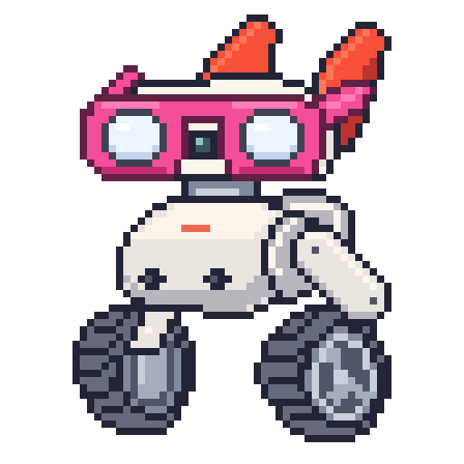

  

<h1 align="center">Awesome Beni</h1>

Everything open source around <b>Beni</b>, the Mondo Robotics robot.

<i>Nothing is either awesome or lame, but stars make it so.</i>

  

  <a href="readme.md">English</a> · <a href="readme.zh-CN.md">简体中文</a>

## Projects

- [Beni SDK](https://github.com/Mondo-Robotics/Beni-SDK) - Local-network SDK with a user guide, the 78-protocol reference and HMS fault codes.
- [Open Beni](https://github.com/Mondo-Robotics/Open-Beni) - Browser racing game with the MuJoCo training source, web client and robot assets behind it.

## Contributing

Contributions are welcome. Read [contributing.md](contributing.md) first, and keep every entry to a single line with a link and one sentence on why it belongs here. This project follows the [Contributor Covenant](code-of-conduct.md).

Published under [CC0 1.0](license).
